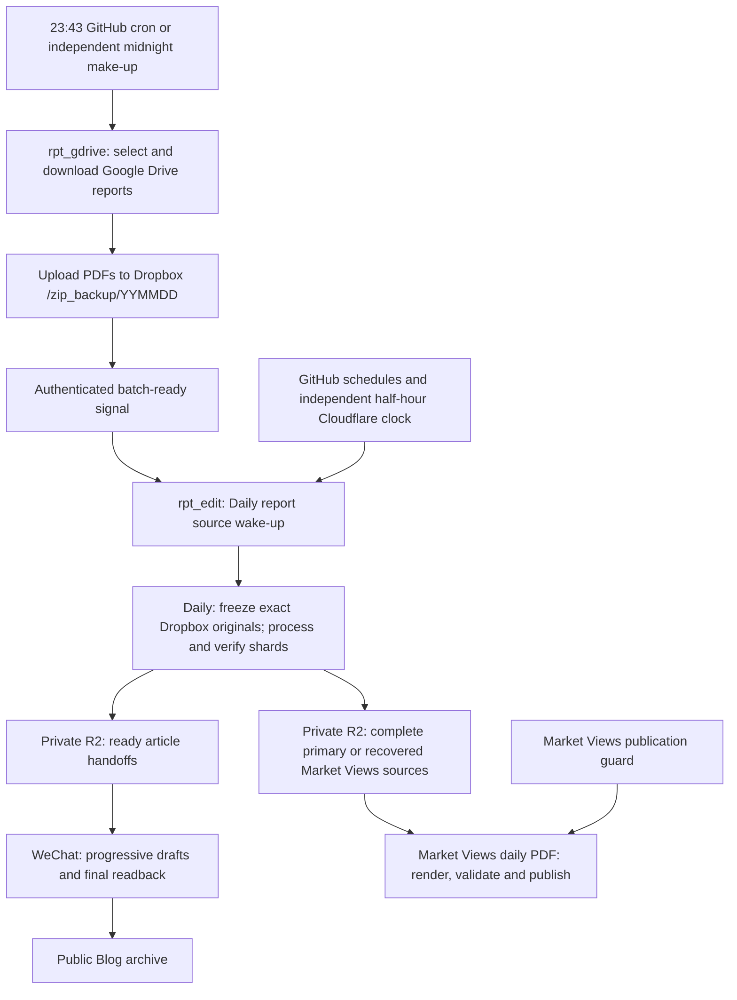

# Daily Dropbox report handoff

Reviewed 2026-11-25. All times below are Asia/Shanghai. A batch is identified by
the date of its Dropbox source folder, normally the previous calendar day.

## Source and admission

| Owner | Workflow | Responsibility |
| --- | --- | --- |
| `rpt_gdrive` | `GDrive to Dropbox Sync` | Select Google Drive reports, prepare dated folders and upload PDFs under `/zip_backup/YYMMDD`. The GitHub schedule is 23:43 Beijing time, and sync runs use a serialized queue. |
| `rpt_edit` | [Daily report source wake-up](../.github/workflows/daily-report-source-wakeup.yml) | Validate Dropbox batch readiness and dispatch the Daily workflow with `dropbox_date_folder` set to the exact date. |
| `rpt_edit` | [Daily report articles and translations](../.github/workflows/dropbox-latest-pdf-to-xhs-sharded.yml) | Freeze original identities, run the sharded MinerU pipeline and verify article, PDF and translation delivery independently. |

The GitHub schedule at 23:43 is the first start opportunity. From midnight,
the isolated half-hour Cloudflare clock checks the live upstream workflow
inventory for the preceding source date. If the scheduled run has not started,
or has failed, it can dispatch `rpt_gdrive` on `main` with `clock_sync_date`
bound to that date. A native run in flight or completed successfully suppresses
the make-up dispatch. R2 conditionally claims a dispatch, and the next tick
reconciles uncertain outcomes with GitHub. A confirmed failed make-up run can
be retried once. The source workflow serializes both triggers and uses the
verified dated completion to skip a later duplicate download. If an already
queued make-up run follows a successful native run, it can read back the
exact Dropbox folder without downloading from Drive again.

Set the downstream repository variable `REPORT_UPSTREAM_SYNC_REPO` to the
source repository and use the deploy workflow to install the controller.
The existing Worker Actions credential needs access to `sync.yml` in that
repository. The deploy workflow's `inspect_only` mode reads the most recent
upstream check, the downstream wake-up receipt, and the Cloudflare schedule.

After its Dropbox writes succeed, the sync selects the newest date it wrote
from the current or previous Beijing calendar day. It lists the folder and
verifies that every newly written revision is visible. The signal describes
all PDFs in that date folder. A dated make-up run checks its expected Drive download batch and binds the
receipt to that exact Dropbox date. A Dropbox upload failure stops the ready signal.

The upstream workflow sends the batch-ready signal to the isolated
`portal-daily-source-clock` Cloudflare Worker at `/dropbox-report-batch-ready`.
The upstream repository sets the `RPT_EDIT_WAKEUP_URL` variable to the relay URL.
Both repositories store the same dedicated 64-hex-character GitHub Actions
secret named `REPORT_HANDOFF_SIGNING_KEY`. The downstream deployment loads it
into the Worker. The upstream workflow computes HMAC-SHA-256 over the Unix
timestamp, a single line feed, and the exact JSON request body bytes. It sends
the signature in `Authorization: ReportHMAC <unix_seconds>.<lower_hex_hmac_sha256>`.
The relay verifies the signature and accepts timestamps within five minutes
of receipt. The signing key authenticates this route. The Worker uses its
separate GitHub Actions credential to dispatch the source wake-up on `main`.

The source wake-up accepts four `workflow_dispatch` inputs for the immediate
handoff. All four belong to the same batch.

| Input | Value |
| --- | --- |
| `date_folder` | Exact Dropbox date in `YYMMDD` format. |
| `upstream_run_id` | Positive GitHub Actions run ID from `rpt_gdrive`. |
| `pdf_count` | Positive count of all PDFs in the exact date folder, including subfolders. |
| `manifest_sha256` | Lowercase hex SHA-256 of the sorted Dropbox file ID and revision pairs, encoded as UTF-8 `id<TAB>rev<LF>` lines. |

The receiver independently lists the exact Dropbox folder and checks the count
and digest against current PDF metadata. A matching proof for the previous
Beijing date allows admission immediately, even from 00:00 to 02:00. A receipt
for the current date can use the same path at or after 02:00. Verified
admission skips the ordinary 15-minute settling delay. The wake-up reports `source_proof: verified`
even if an active Daily run prevents dispatch. A relay acknowledgement confirms
GitHub accepted a wake-up request. The wake-up record provides the Dropbox
proof and the resulting Daily run ID or hold reason. Calls with all four inputs
blank use ordinary polling readiness from 02:00. The Daily workflow freezes the original PDF
bytes for the admitted date when it selects the reports to process.

The Daily source workflow serializes wake-ups and checks for an active Daily
run before admitting a new batch. Repeated signals and polling use the same
admission check, which recognizes an attempted date using trusted run titles
and source artifacts. A run with an uncertain dispatch result is looked up by
its exact date and workflow identity before recovery. Dropbox metadata checks
run on the 02:00 GitHub schedule, hourly GitHub checks, and a separate Cloudflare
clock every half hour. A polling check admits the latest date when it falls
within the current or previous Beijing calendar day and all PDFs have settled
for at least 15 minutes according to Dropbox server timestamps. This also covers
late writes after a mismatched proof and a missed relay signal. For a reviewed
source handoff recovery, the upstream workflow's `notify_existing_date` input
can read a date folder settled for at least 15 minutes and send a fresh signal
without copying files. An already attempted date, including one with later file
additions, requires review against the retained original manifest before replay.

## Google Drive arrival audit

A read-only inventory of the configured source folder on November 24 covered
1,224 current PDFs. The comparison uses 22 complete modified-date batches from
November 2 through 23, excludes trashed files and PDFs at or above 10 MiB, and
uses the later of Drive `createdTime` and `modifiedTime` when evaluating each
cutoff. The sync assigns the batch date from Beijing `modifiedTime`.
These fields describe the file and do not record every historical move into
the source folder.

| Beijing cutoff | Eligible PDFs whose creation and modification timestamps precede cutoff | Whole batches |
| --- | --- | --- |
| 22:00 | 869 of 1,133 | 8 of 22 |
| 22:13 | 893 of 1,133 | 10 of 22 |
| 23:43 | 1,129 of 1,133 | 21 of 22 |

The latest same-day creation was 23:18:29 on November 13. The other four
eligible files belong to the November 16 modified-date batch and were created
around 19:30 on November 17. The 23:43 schedule leaves about 25 minutes after
the latest observed same-day creation. Late historical additions to an already
attempted date remain subject to the dated recovery path.

All 48 eligible PDFs in batch `261123` matched the November 24 sync log.
Their latest creation and modification timestamps were 20:36:40 and
20:32:56 on November 23. The current inventory shows zero files created
and zero files modified from November 23 at 22:13 through November 24 at
09:26:03. The workflow's scheduled event is independent of this inventory.

## Delivery and recovery

- **WeChat and Blog.** A verified article shard in private R2 can wake
  [Progressive Daily WeChat delivery](../.github/workflows/progressive-wechat-delivery.yml).
  It runs on the WeChat runner, reads the Daily run's frozen draft groups and
  publishes groups that are ready. The final Daily delivery gate verifies draft
  receipts and exact WeChat readback before accepting the Blog archive. The
  default is draft upload. WeChat freepublish is an explicit opt-in.
- **Market Views.** The Daily run dispatches
  [Market views daily PDF](../.github/workflows/market-views-latex-pdf.yml)
  with the exact date and private R2 handoff run ID when the primary or
  recovered source set is complete. The parent waits for the accepted child
  run. The [publication guard](../.github/workflows/market-views-daily-guard.yml)
  also checks hourly and on completion of Daily or Market Views. Its 06:00
  cutoff and exact-date checks let it recover a missing issue independently
  from verified available sources.
- **Separate outputs.** Inspect the Daily run's report and PDF validation jobs
  separately. An accepted dispatch, a successful source upload or an R2 shard
  proves progress through its own stage. Verify WeChat draft readback and the
  dated live Market Views issue to confirm delivery. The separate
  [Dropbox report source catch-up](../.github/workflows/portal-dropbox-report-catchup.yml)
  serves the Neutral catalog refresh.

Start incident review with the upstream run's creation, runner start and last
successful Dropbox upload. Next inspect the wake-up outcome and the exact date
in the Daily run title. If a Daily already admitted that date, inspect its
checkpoints, child Market Views run and WeChat delivery receipts before choosing
a targeted recovery. Use the retained original manifest and private artifacts
for a reviewed replay of that date.

## 2026-11-24 incident

| Time | Observed stage |
| --- | --- |
| 08:59 | The Market Views guard (`45301368148`) rejected the stale source. |
| 09:02 | The source wake-up (`45301737306`) still saw `261122` and waited for a fresh batch. |
| 09:26 | GitHub created the upstream scheduled sync (`45305004834`). Its job started two seconds later. |
| 09:44 | The upstream run completed the Dropbox upload for `261123`. |
| 10:01 | The source wake-up (`45309162925`) admitted `261123` with 48 PDFs and verified the Daily dispatch (`45309350829`). |

GitHub created the sync run 11 hours 26 minutes after the former 22:00 schedule.
Runner startup took two seconds, and the job finished in about 18 minutes. All
48 Drive downloads attempted for `261123` succeeded and produced 48 new Dropbox
writes. The same log recorded 112 HTTP 403s during downloads for earlier dates
in the sync lookback (`261119`, `261120`, `261121`).

## 2026-11-25 incident

The 23:43 November 24 GitHub schedule created its first run at 08:06:39 on
November 25, 8 hours 23 minutes after its configured time. Its runner started
three seconds later. The downstream clock had been checking Dropbox overnight
and only had the previous source batch. The independent clock now checks the
upstream start as well as the downstream handoff.
